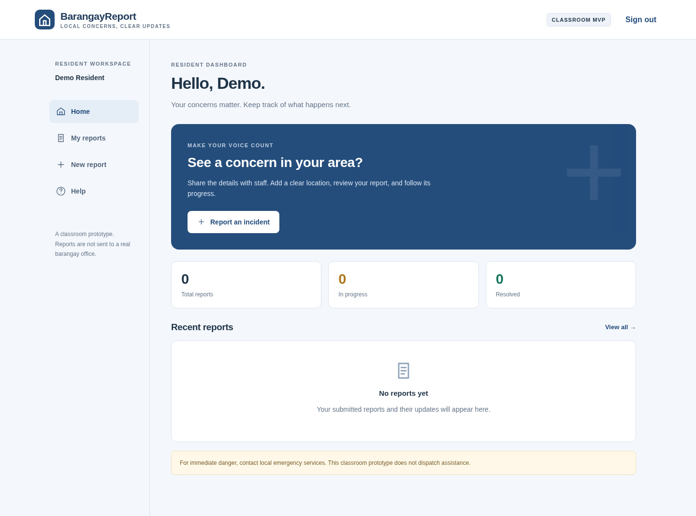
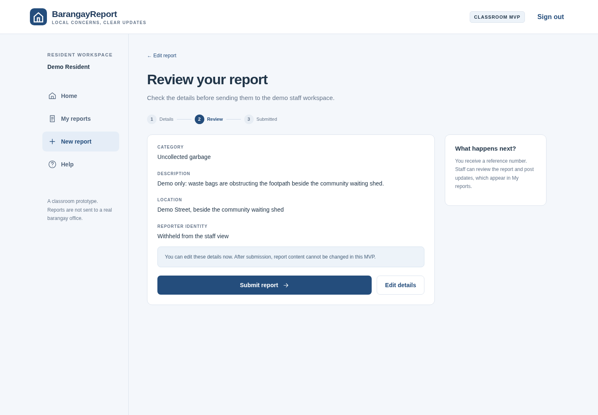
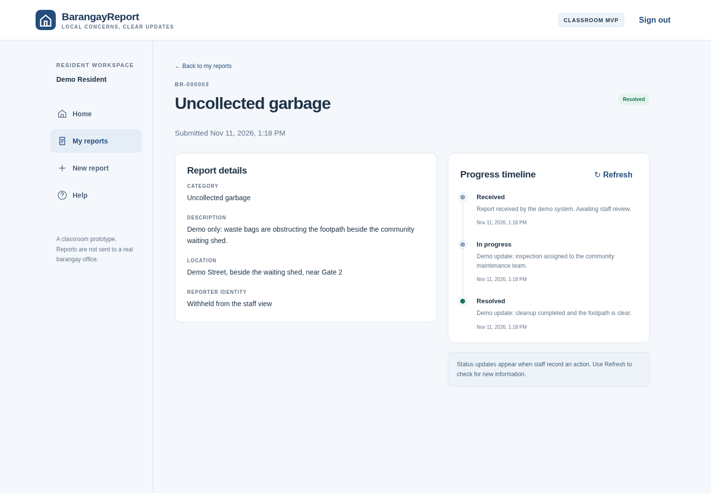

## Part 3 — MVP Development and Testing

Project: BarangayReport | BSIT 2 – Block 2 | Version 0.1.0 | Evidence prepared: 11 November 2026

Members: Mark Angelo Mariño; Jacinth Dhane Mendoza; John Harold Padilla; Aljun Galanida; Josh Philip Gonzales

Evidence status: working MVP and developer testing completed; representative-user testing and user feedback are still pending. This report does not claim instructor approval, real barangay deployment, or testing by three people.

## 1. Project overview and customer problem

BarangayReport helps residents record a local concern and follow what happens after submission. The working problem statement is that residents need a clear way to report a concern with its location, receive an acknowledgement, and see progress. This statement is inferred from the supplied Part 2 user flow; Part 1 research was not supplied, so the team should confirm the wording against its original customer findings.

The MVP implements the Part 2 sequence: Login/Register → Home → New Report → Review → Submit with reference number → My Reports with status and timeline. A staff workspace was added to make status updates functional from end to end. The product is a responsive web application, not an Android APK, and uses fictional demonstration data.

## 2. Checklist and evidence readiness

| Requirement | Current status and evidence |
| --- | --- |
| Initial MVP developed | Implemented. Runnable server, resident interface and staff workspace are included in the source folder. |
| Core features address the customer problem | Implemented against the Part 2 flow. Reporting, acknowledgement and progress tracking are available. Validate the inferred problem statement with the team’s Part 1 research. |
| Live or recorded demonstration | Available. Local app at http://127.0.0.1:3300 and a recorded walkthrough in evidence/. |
| Functional testing completed | Completed for the documented scope: 20 API checks and 13 automated browser checks passed. |
| Three representative users, or approved alternative | Pending. No human participant sessions or instructor approval were supplied. A plan and blank records are included. |
| User feedback and identified problems recorded | Partial. Developer-detected startup and sign-out issues and their fixes are documented. Representative-user feedback has not yet been collected. |
| Improvements based on testing results | Implemented: startup and sign-out defects were corrected and the workflow retested. Further usability revisions await real feedback. |
| Remaining bugs, limitations and next steps | Documented in Section 8 and the limitations register. |

Do not mark all eight checklist items complete until the missing human-testing/approved-alternative evidence and feedback records exist.

## 3. Implemented MVP and design decisions

| Feature | What the working MVP does |
| --- | --- |
| Accounts | Resident registration and sign-in; salted password hashes; server-side sessions; separate staff role. |
| New report | Required category, description and manual location; optional JPG/PNG photo up to 2 MB and optional GPS coordinates. |
| Review and submit | Review screen, edit/back navigation, validation on client and server, submission acknowledgement and unique BR reference. |
| Report tracking | Resident-only report list, reference/text search, status filters and chronological updates. Data persists in SQLite. |
| Staff updates | Staff queue; received, in-progress and resolved states; required resident-visible update note; previous events remain available. |
| Identity withholding | An anonymous toggle hides name and mobile in staff responses and the interface. The account remains linked internally; this is not full anonymity. |
| Error handling | Field-level errors, network-failure message with draft retained in memory, duplicate-submission retry protection, GPS-denial manual fallback. |

Technology: Node.js 24.19.0, built-in HTTP and SQLite 3.53.3, HTML, CSS and browser JavaScript. No runtime third-party packages are required. This small structure keeps the project easy to run and explain.

Data flow: browser → authenticated HTTP endpoint → SQLite → structured response → updated interface. Tables: users, sessions, reports and events. Each report belongs to one resident; each report has a chronological event history. Access checks run on the server, not only in the interface.

HCI decisions retained from Part 2: visible status labels and reference numbers; consistent navigation and controls; confirmation and inline feedback; labeled actions; review-before-submit; and user control through edit/back navigation and identity withholding. A mobile bottom navigation is provided on narrow screens.

## 4. Functional testing method and results

Developer checks were executed on 11 November 2026. API tests ran on a separate temporary database and server on port 3397; browser checks exercised the local demo on port 3300 using Chromium and Playwright 1.64.1. These are automated developer tests, not representative-user sessions.

Result: all 20 named API checks passed. The TAP summary shows 21 passes because it includes the parent test in addition to the 20 checks. Evidence: evidence/api-tests.tap and test/api.test.mjs.

| ID | Executed check | Result |
| --- | --- | --- |
| F01 | unauthenticated requests cannot list reports | PASS |
| F02 | account validation rejects incomplete registration | PASS |
| F03 | resident registration creates a session without leaking password | PASS |
| F04 | duplicate accounts are rejected | PASS |
| F05 | incorrect password does not authenticate | PASS |
| F06 | category, description and location are validated on server | PASS |
| F07 | invalid GPS coordinates are rejected | PASS |
| F08 | non-image data cannot be uploaded as a photo | PASS |
| F09 | submission produces a reference and an initial timeline event | PASS |
| F10 | retrying a submission does not create a duplicate | PASS |
| F11 | another resident cannot read a report or its photo | PASS |
| F12 | residents cannot update status | PASS |
| F13 | staff can sign in and anonymous identity is withheld | PASS |
| F14 | staff update appears in resident timeline | PASS |
| F15 | invalid and redundant status updates are rejected | PASS |
| F16 | resolved status preserves earlier history | PASS |
| F17 | photo storage and authorized retrieval work | PASS |
| F18 | cross-site mutation attempts are rejected | PASS |
| F19 | reports and history survive a server restart | PASS |
| F20 | logout invalidates the server session | PASS |

The persistence check stops and restarts the server before reading the saved report and history. The access checks use distinct resident sessions. Photo testing verifies permitted retrieval and rejects disguised non-image content; it is not a full malware or image-parser security assessment.

## 5. Browser workflow verification

Result: all 13 documented browser checks passed after the startup and sign-out fixes. Evidence: evidence/browser-results.json, evidence/browser-run.log, and screenshots 01–13. The first failed browser run is retained separately for traceability.

| ID | Observed automated result | Result |
| --- | --- | --- |
| B01 | A resident can register through the interface and reach the dashboard. | PASS |
| B02 | Required fields show inline errors and the first invalid field receives focus. | PASS |
| B03 | Review-to-edit retains form data and shows the revised location. | PASS |
| B04 | Submission confirms a reference and opens the resident timeline. | PASS |
| B05 | Anonymous reporter name and mobile are hidden in staff detail. | PASS |
| B06 | A staff update appears on the resident timeline after refresh. | PASS |
| B07 | Resolution preserves all three timeline entries. | PASS |
| B08 | Search and status filters return the matching report or an empty state. | PASS |
| B09 | 390px mobile detail layout has no horizontal overflow. | PASS |
| B10 | GPS denial leaves manual location entry available. | PASS |
| B11 | Network failure keeps the report draft available for correction and retry. | PASS |
| B12 | No uncaught browser JavaScript errors during the tested flow. | PASS |
| B13 | Sign-out returns to sign-in and permits resident-to-staff switching in the same browser. | PASS |

Scope limits: one desktop Chromium environment, a 390 px mobile viewport, and automated interaction. No physical Android/iOS device testing, assistive-technology audit, public-network deployment testing, or representative-user usability study was performed.

## 6. Demonstration and source evidence

Run instructions: install Node.js 24 or newer; open the source folder; set STAFF_PASSWORD to a local demo password of at least 12 characters; run npm start; open http://127.0.0.1:3300. README.md contains Windows and macOS/Linux commands. Staff demo mobile is 09990000001. Create a resident account through the interface.

The guided recording demonstrates resident registration, field validation, review/edit, submission, reference tracking, staff sign-in, status updates, and the resident’s final timeline. All incident details are fictional. The separate short automated test recording is retained as functional evidence. Neither recording represents a participant study.

| Evidence | Location |
| --- | --- |
| Working source and run instructions | server.mjs; public/; package.json; README.md |
| Guided demonstration | evidence/BarangayReport-Guided-Walkthrough.mp4 |
| Automated browser recording | evidence/BarangayReport-Functional-Walkthrough.mp4 |
| Executed test results | evidence/api-tests.tap; evidence/browser-results.json |
| Interface screenshots | evidence/screenshots/01-login.png through 13-mobile-form.png |
| Revision record | docs/Revision-Log.csv; Section 7 |
| Human testing plan and blank forms | docs/User-Testing-Plan.md; Participant-Tasks.csv; User-Feedback.csv |
| Remaining work | docs/Limitations-and-Next-Steps.md; Section 8 |

## 7. Problems found and revisions made

| ID / source | Issue | Change and verification |
| --- | --- | --- |
| R01 / browser smoke test | The initial browser run could not reach the login screen. A malformed template-string delimiter in the review screen caused a JavaScript parse error. | Corrected the delimiter; node --check passed; reran the workflow and obtained 13 browser passes with no uncaught page errors. See browser-first-run.txt and browser-results.json. |
| R04 / guided same-browser demo | After resident registration and sign-out, the registration tab remained selected, interrupting sign-in as staff. | Reset the authentication view to sign-in on logout. Added B13 and verified resident-to-staff switching in the same browser. |
| R02 / evidence review | The test runner’s summary included the parent test, which could be mistaken for an additional functional scenario. | Saved a TAP report with stable F01–F20 identifiers and explained why the summary contains 21 passes. |
| R03 / presentation preparation | The automated browser recording was too fast to explain the workflow comfortably. | Added a separate guided capture with deliberate reading pauses and both resident and staff actions. This is a presentation improvement, not user feedback. |

No quotations, satisfaction scores, participant counts or user-requested fixes have been invented. The revisions above came from developer verification and evidence review. Additional revision rows should be added only after an actual problem has been observed, a change made, and its retest result recorded.

## 8. Remaining bugs, limitations and next steps

No unresolved failure was observed in the 33 named automated checks after the fix. This does not establish that the application is bug-free. The following limitations are known and should be disclosed during the demonstration.

| Area | Remaining limitation / next step |
| --- | --- |
| User validation | Recruit three representative participants, execute the tasks, retain feedback, prioritize findings and retest improvements. |
| Deployment | Local classroom app only; no real barangay connection, dispatching, service-level promise or production hosting. |
| Accounts | No OTP/mobile verification, password recovery or staff-account management interface. |
| Data handling | No submitted-report editing/deletion, retention policy, backup/restore workflow, or photo metadata stripping. Raw photo content is not comprehensively decoded/scanned. |
| Drafts and updates | Draft survives in-page navigation and network failure, but refresh clears it. Updates require refresh; no SMS/push notifications. |
| Location and compatibility | GPS depends on permissions and a secure context. Manual location remains available. Test actual phones and other browsers next. |
| Production robustness | Add pagination, deployment-specific rate limiting/session hardening, moderation, auditing and a formal security/accessibility review before public use. |

## 9. Representative-user testing plan — not yet executed

Purpose: determine whether intended users can submit a complete report, understand identity withholding, find their reference and interpret status updates without unnecessary assistance. Proposed participants: P01, a resident comfortable with smartphone apps; P02, a resident with less digital experience or an older adult who uses a phone; P03, a barangay staff member or a suitable instructor-approved staff-role representative. Record the basis for each participant’s representativeness.

Procedure: explain the classroom-only setting, obtain consent for notes or recording, use fictional incidents, and let each participant attempt tasks without coaching. Record completion, time, errors, assistance and verbatim comments. Do not collect passwords or unnecessary personal identifiers. Use participant codes in the report.

| Task | Expected observable outcome |
| --- | --- |
| T01 / resident | Register/sign in and locate the reporting action. |
| T02 / resident | Submit an empty form, interpret errors, and correct the required fields. |
| T03 / resident | Enter a fictional concern and manual location; optionally add a photo and try GPS. |
| T04 / resident | Explain the anonymous toggle, review details, edit a field, and submit once. |
| T05 / resident | Find the reference number and explain the current status and timeline. |
| T06 / staff | Find a report, post an in-progress update, and later resolve it with a clear note. |
| T07 / resident after staff action | Refresh and correctly identify the latest update. |

Success targets (planned, not achieved user results): each resident completes the submit-and-track flow without a critical blocker; the staff participant updates a report successfully; participants understand that reports stay in a classroom demo and that identity withholding is limited. These are practical criteria for a small exploratory study, not a statistical usability claim.

Feedback prompts: What was confusing? What did you expect after tapping Submit? What does anonymous mean here? Could you tell what happened to the report? What one change would make this easier? Record comments exactly, then record the team’s interpretation separately.

Instructor-approved alternative: if three representative users are not available, submit this plan for written approval, agree on the replacement activities, perform those activities, and retain the approval plus execution evidence. A drafted plan alone does not meet the checklist requirement.

After testing: complete the feedback and task sheets, prioritize critical/high/medium/low issues, implement justified changes, add dated revision-log rows with links to evidence, rerun affected tests, and update the checklist. Team contributions and any instructor approval should be confirmed by the team rather than assigned without evidence.